# OCeanic RMM

A self-hosted remote monitoring and management (RMM) tool for homelabs, similar in spirit to NinjaOne, that runs from a single Docker container.

- **No open ports.** The server sits behind a Cloudflare Tunnel. Agents only make outbound HTTPS calls, so nothing on your router or firewall changes.
- **One-click Windows installers.** The dashboard generates a `Setup.exe` for each organization with the server URL and enrollment token built in. Double-click it, run it silently with `/S` (GPO, Intune, PDQ), or use a PowerShell one-liner.
- **macOS agents.** Intel and Apple Silicon, installed with a one-liner as a launchd service, including remote desktop.
- **Linux agents too.** Builds for x64, ARM64 and ARMv7 (Raspberry Pi), installed as a systemd service.

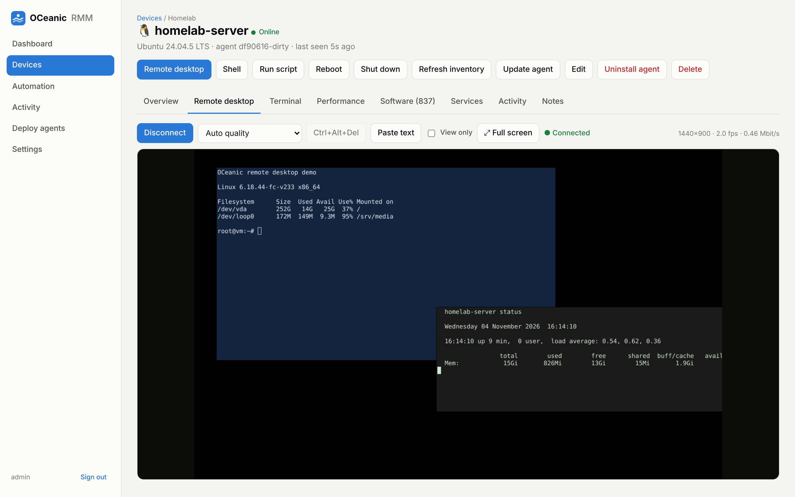

## Screenshots

| | |
|---|---|
| 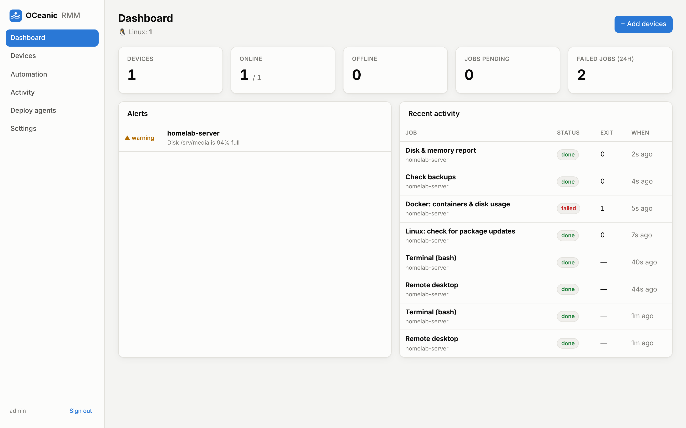 **Dashboard:** fleet health, alerts, and recent activity | 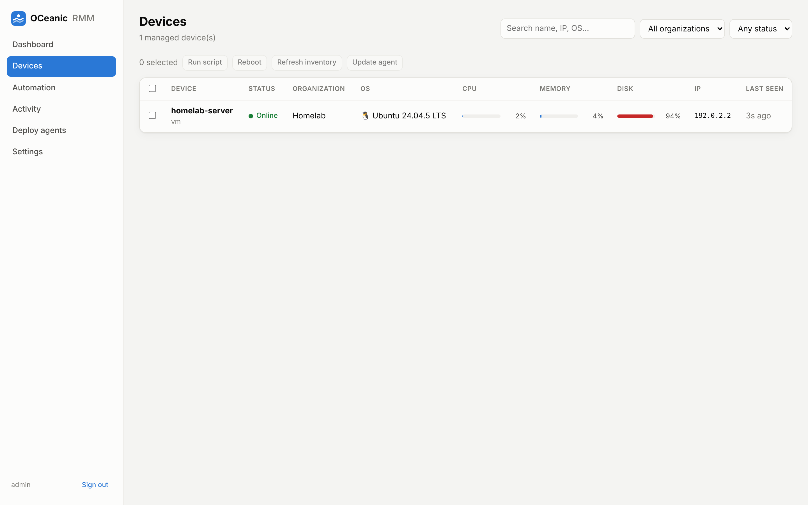 **Devices:** live CPU, memory, and disk across every machine |
| 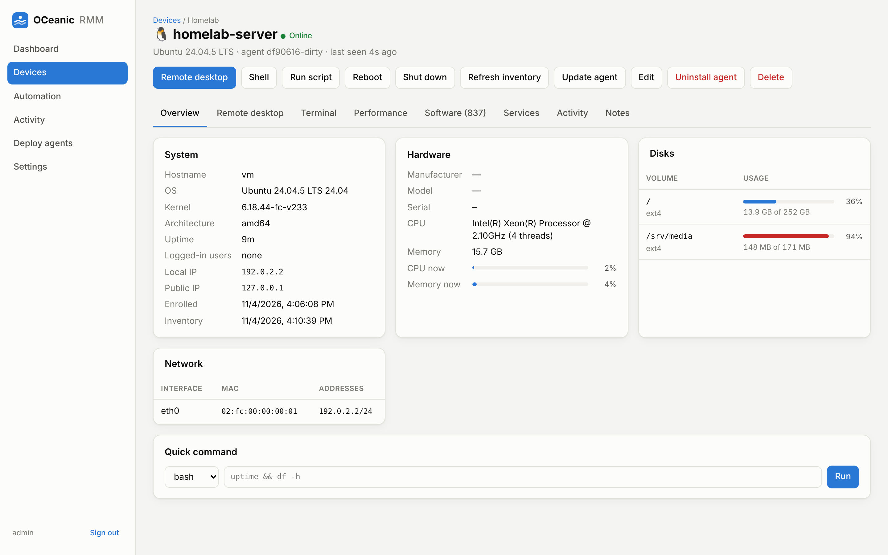 **Device overview:** system, hardware, disks, and network | 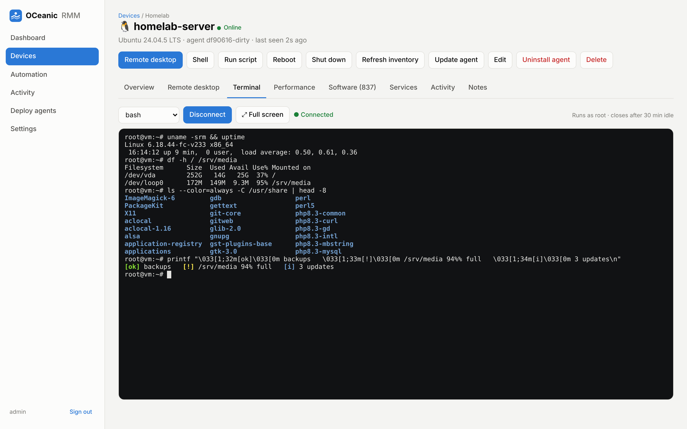 **Terminal:** interactive PowerShell, cmd, bash, or zsh in the browser |
| 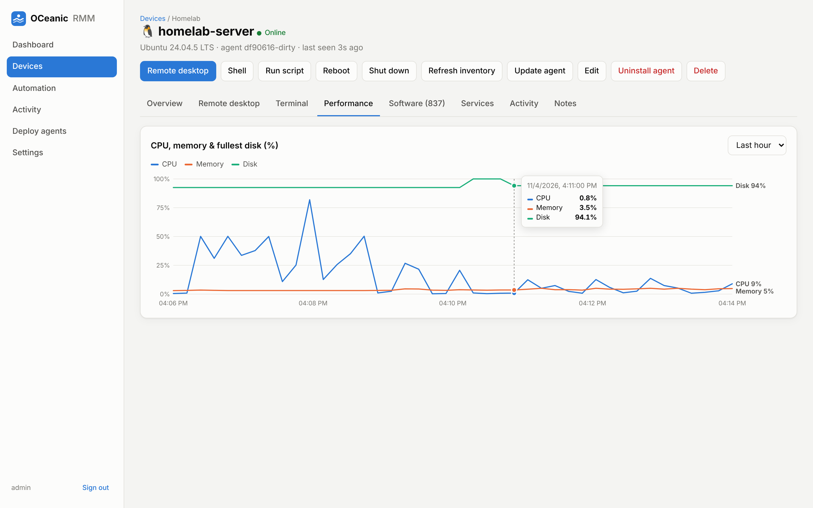 **Performance:** CPU, memory, and disk history | 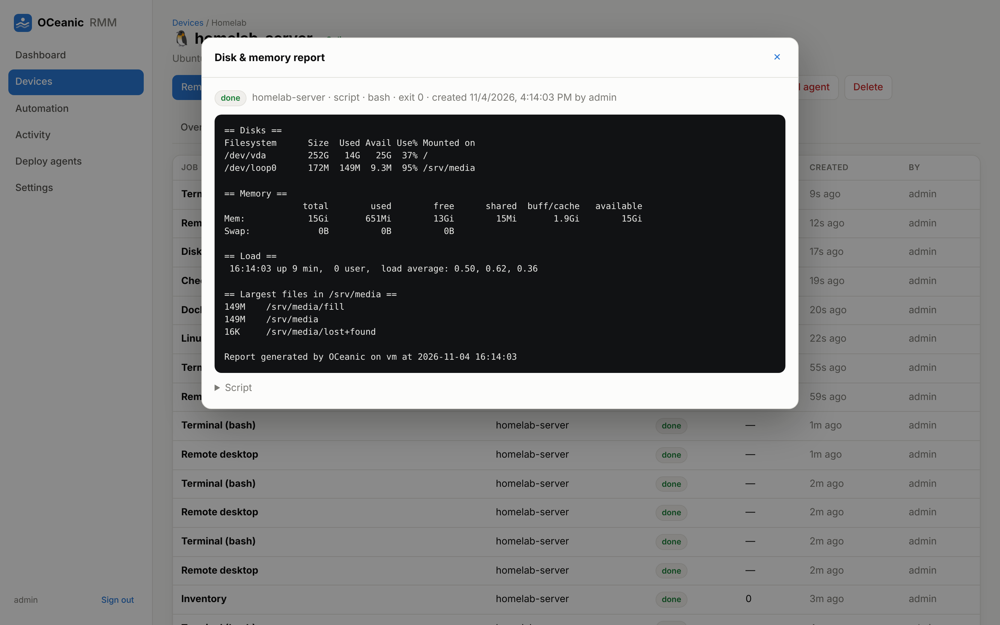 **Script results:** output and exit code for every job |
| 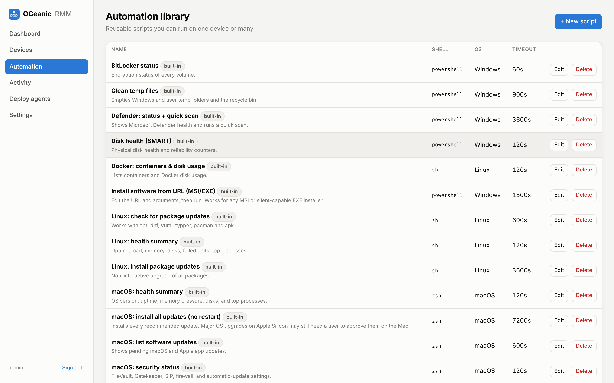 **Automation library:** built-in Windows, Linux, and macOS scripts | 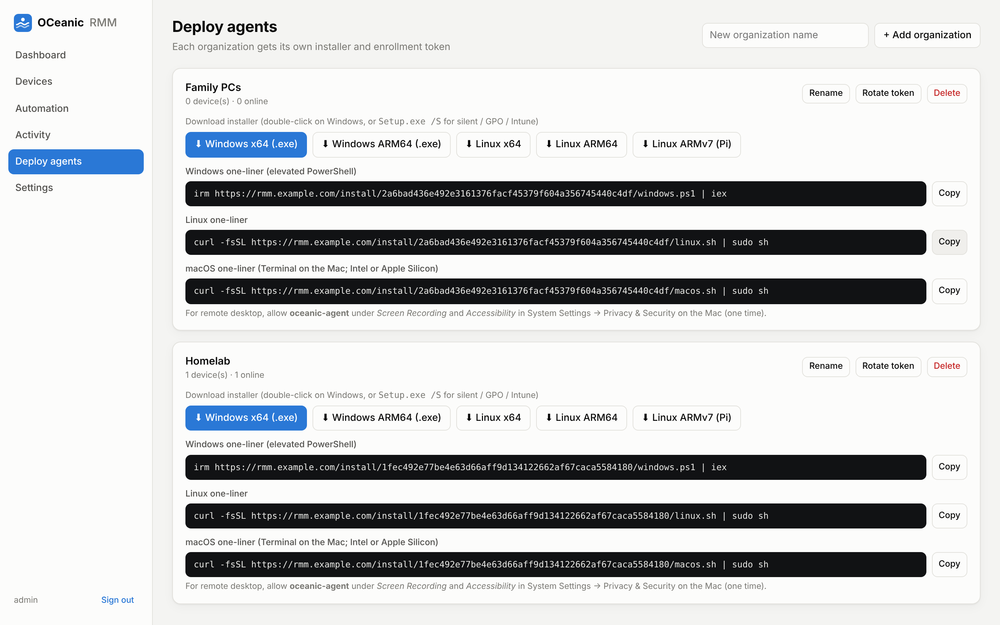 **Deploy:** per-organization installers and one-liners |
| 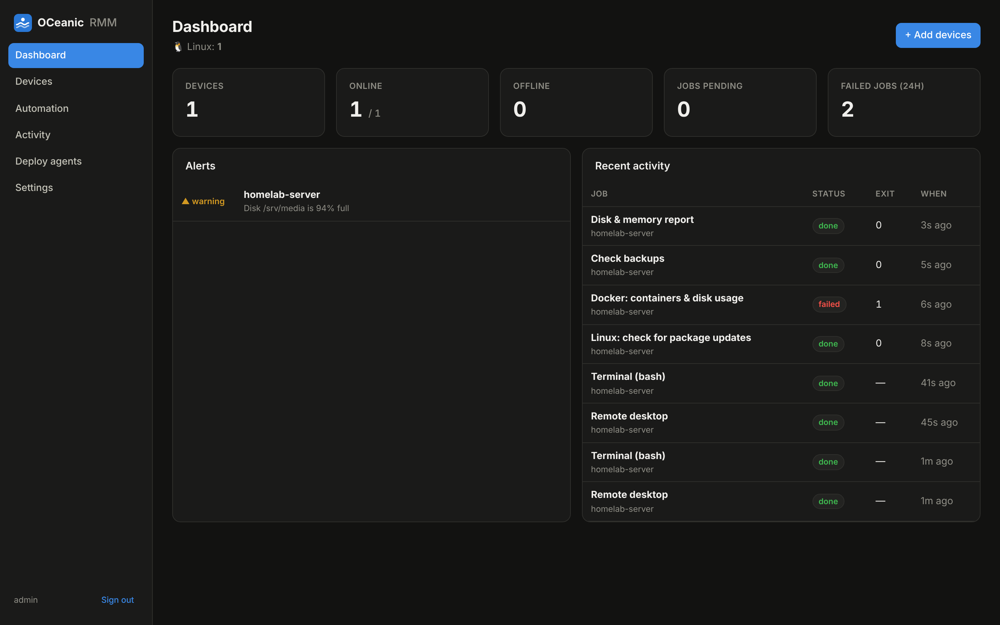 **Dark mode:** follows your system setting | 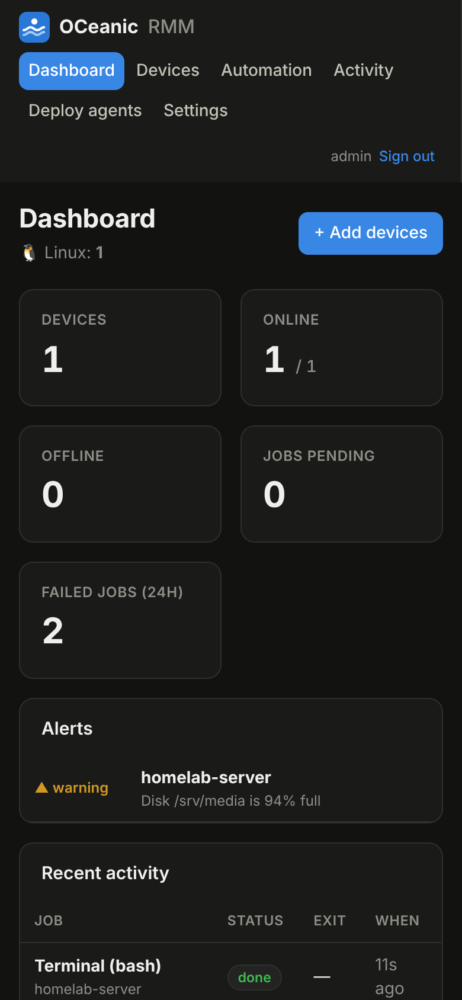 **Mobile:** works on a phone, too |

## Features

| | |
|---|---|
| **Monitoring** | Online/offline status, CPU, RAM and per-disk usage, uptime, logged-in users, local and public IP. Includes 7-day performance charts. |
| **Inventory** | OS and build, CPU, RAM, manufacturer, model, serial, NICs, installed software (registry, dpkg, rpm, apk, pacman) and services. |
| **Alerts** | Fires when a device goes offline, a disk reaches 90%, or memory reaches 95%. Shown on the dashboard and optionally pushed to a Discord, Slack, Mattermost or ntfy webhook. |
| **Remote desktop** | View and control the screen from the browser: mouse, keyboard, wheel, paste text, Ctrl+Alt+Del, view-only mode, full screen with keyboard lock, and 4 quality levels. Only changed regions are sent, as JPEG tiles with flow control. On Windows it follows you onto the login screen and UAC prompts. Linux is supported on X11 desktops. macOS is supported after a one-time permission approval on the Mac. |
| **Remote terminal** | Interactive PowerShell, cmd, PowerShell 7, bash or sh in the browser (xterm.js). It uses a real PTY: Windows ConPTY and Linux pty. Colors, tab completion, Ctrl+C, `vim` and `htop` all work. Window resizing and full-screen mode are supported. Sessions are audited and close after 30 minutes idle. |
| **Remote scripting** | PowerShell, pwsh, cmd, bash, sh and Python, run as SYSTEM or root. Each job has a timeout and captures output and exit code. Jobs reach online agents in under a second through long-polling. Offline devices pick them up when they reconnect. |
| **Automation library** | Built-in scripts: Windows Update (list or install), winget upgrade-all, Defender scan, BitLocker status, SMART disk health, event log errors, temp cleanup, install any MSI/EXE from a URL, Linux package updates, health summary, Docker status. You can add your own. |
| **Actions** | Reboot, shutdown, start/stop/restart services, refresh inventory, self-update agent, remote uninstall. All of these work in bulk across selected devices. |
| **Organizations** | Group devices by site or client. Each organization has its own installer and an enrollment token you can rotate. |
| **Audit log** | Records every login, job, installer download and change. |

## Quick start

### 1. Create a Cloudflare Tunnel

1. Go to [Cloudflare Zero Trust](https://one.dash.cloudflare.com/), then **Networks → Tunnels → Create a tunnel**, and pick **Cloudflared**.
2. Name the tunnel (for example `homelab-rmm`). On the "Install connector" step, copy the **token**, which is the long string after `--token`. You don't need to install anything; docker compose runs the connector.
3. Under **Public Hostname**, add:
   - Subdomain/domain: `rmm.example.com`
   - Service: **HTTP** → `oceanic:8080`

### 2. Start OCeanic

The image is published to GitHub Container Registry for x86-64 and ARM64 (Raspberry Pi 4/5, ARM NAS boxes), so there's nothing to build. Pick whichever option suits your setup.

**Option A: one-line setup.** This asks for your tunnel token and hostname, generates an admin password, and starts everything:

```bash
curl -fsSL https://raw.githubusercontent.com/imshodj/OCeanic/main/install.sh | sh
```

**Option B: Docker Compose by hand.**

```bash
mkdir oceanic && cd oceanic
curl -fsSLO https://raw.githubusercontent.com/imshodj/OCeanic/main/docker-compose.yml
curl -fsSL  https://raw.githubusercontent.com/imshodj/OCeanic/main/.env.example -o .env
nano .env        # set CLOUDFLARE_TUNNEL_TOKEN, OCEANIC_PUBLIC_URL, OCEANIC_ADMIN_PASSWORD
docker compose up -d
```

**Option C: Portainer, Dockge, Unraid or Synology.** Create a new stack. Paste in [`docker-compose.yml`](docker-compose.yml). Add the variables from [`.env.example`](.env.example) as stack environment variables, then deploy.

**Option D: a plain `docker run`.** Use this if you run `cloudflared` separately and it can reach port 8080:

```bash
docker run -d --name oceanic --restart unless-stopped -p 127.0.0.1:8080:8080 \
  -v oceanic-data:/data \
  -e OCEANIC_PUBLIC_URL=https://rmm.example.com -e OCEANIC_ADMIN_PASSWORD='change-me-please' \
  ghcr.io/imshodj/oceanic:latest
```

Open `https://rmm.example.com` and sign in as `admin`. If you didn't set a password, run `docker compose logs oceanic` to see the one that was generated.

**Updating:** run `docker compose pull && docker compose up -d`. To stay on a specific release, set `OCEANIC_VERSION=1.0.0` in `.env`. After updating the server, select your devices and click **Update agent** so the agents get the new build too.

**Building it yourself:** after `git clone`, run `docker compose -f docker-compose.yml -f docker-compose.build.yml up -d --build`.

> **If this repository is private:** the image on ghcr.io is private too. Run `docker login ghcr.io -u <your-github-username>` once on the Docker host, using a [personal access token](https://github.com/settings/tokens) with the `read:packages` scope as the password. The `curl` commands above also only work when the repository is public. For a private repository, clone it instead.

### 3. Deploy agents

In the dashboard, go to **Deploy agents**. Then use one of these:

- **Windows (interactive):** click **Windows x64 (.exe)** and run the file on the target PC. It asks for UAC elevation, installs the `OCeanic RMM Agent` service, and shows a confirmation.
- **Windows (silent, GPO, Intune or any RMM):** `OCeanic-Agent-Homelab-amd64-Setup.exe /S`
- **Windows (one-liner, elevated PowerShell):**
  ```powershell
  irm https://rmm.example.com/install/<token>/windows.ps1 | iex
  ```
- **Linux:**
  ```bash
  curl -fsSL https://rmm.example.com/install/<token>/linux.sh | sudo sh
  ```

- **macOS (Terminal on the Mac):**
  ```bash
  curl -fsSL https://rmm.example.com/install/<token>/macos.sh | sudo sh
  ```

The device shows up within a few seconds.

### macOS: one-time permissions for remote desktop

Apple requires the person at the Mac to approve screen capture and remote control. Nothing can bypass this short of an MDM profile. The first time you click **Remote desktop** for a Mac, macOS shows the prompts. If you miss them:

1. On the Mac, open **System Settings → Privacy & Security → Screen Recording**. Turn on **oceanic-agent**. If it isn't listed, click **+**, press **Cmd+Shift+G**, enter `/usr/local/oceanic/oceanic-agent`, and add it.
2. Do the same under **Privacy & Security → Accessibility**. Without this you get view-only access; the dashboard tells you.
3. Click **Connect** again in the dashboard.

Notes:
- **Someone must be logged in.** Sharing the macOS login window isn't supported yet.
- **Updates reset the approval.** The agent is ad-hoc signed, not signed with a paid Apple Developer ID. macOS ties the approval to that exact binary, so after **Update agent** you may need to toggle the two switches off and on again.
- **macOS 15 (Sequoia) re-confirms periodically.** It occasionally asks the person at the Mac to re-confirm Screen Recording for apps that use the classic capture API.
- **Keyboard:** when you control a Mac from a Windows or Linux browser, **Ctrl → ⌘** is on by default, so Ctrl+C / Ctrl+V copy and paste on the Mac.
- **Files:** the agent lives at `/usr/local/oceanic/`, its config at `/etc/oceanic/agent.json`, logs at `/Library/Logs/OCeanic/agent.log`, and the launchd job is `com.oceanic.agent`.

> **SmartScreen / Defender:** the installers are not code-signed, so Windows may show "Windows protected your PC". Click **More info → Run anyway**. Some antivirus products flag any unsigned remote-management tool. If yours does, add an exclusion for `C:\Program Files\OCeanic\`.

## Securing the dashboard with Cloudflare Access (recommended)

Whoever controls the dashboard can run code as SYSTEM/root on every enrolled machine. Put Cloudflare Access (SSO, email OTP, etc.) in front of the UI, and let agent traffic bypass it.

In Zero Trust, go to **Access → Applications** and create three self-hosted applications on the same hostname:

| Application | Path | Policy |
|---|---|---|
| OCeanic dashboard | `rmm.example.com` (no path) | **Allow**: your email or identity provider |
| OCeanic agents | `rmm.example.com/api/agent` | **Bypass**: Everyone |
| OCeanic installers | `rmm.example.com/install` | **Bypass**: Everyone |

Cloudflare applies the most specific path first. Agent endpoints still authenticate on their own: each agent has a per-device secret, and installer links are gated by the organization's enrollment token.

If you'd rather put the whole hostname behind Access, create a **Service Token** and set `OCEANIC_CF_ACCESS_CLIENT_ID` and `OCEANIC_CF_ACCESS_CLIENT_SECRET`. The token gets built into every installer and one-liner, and agents send it on every request.

If you use Bot Fight Mode or strict WAF rules, add a skip rule for `/api/agent/*` so agent check-ins aren't challenged.

## Configuration

All settings are environment variables (see `.env.example`).

| Variable | Default | Purpose |
|---|---|---|
| `OCEANIC_PUBLIC_URL` | *(from request)* | URL built into installers. Set this to your tunnel hostname. |
| `OCEANIC_ADMIN_USER` | `admin` | Dashboard username |
| `OCEANIC_ADMIN_PASSWORD` | *(generated)* | If set, it resets the password on every start |
| `OCEANIC_ALERT_WEBHOOK` | — | Discord, Slack, Mattermost or ntfy URL for alerts |
| `OCEANIC_CF_ACCESS_CLIENT_ID` / `_SECRET` | — | Cloudflare Access service token for agents |
| `OCEANIC_CHECKIN_SECONDS` | `30` | Agent heartbeat interval |
| `OCEANIC_METRICS_RETENTION_DAYS` | `7` | How long performance history is kept |
| `OCEANIC_JOBS_RETENTION_DAYS` | `90` | How long finished job output is kept |
| `OCEANIC_LISTEN` | `:8080` | Listen address inside the container |

Data, a single SQLite file, lives in the `oceanic-data` volume at `/data/oceanic.db`. To back up, copy that file. Run `sqlite3 oceanic.db ".backup x.db"` first if the server is running.

## How it works

```
 Windows / Linux agent ──HTTPS (outbound only)──► Cloudflare edge ◄── cloudflared (outbound) ── oceanic container
        │                                                                                           │
        ├─ POST /api/agent/checkin   every 30s: metrics (+ inventory every 6h)                     SQLite
        ├─ GET  /api/agent/jobs      long-poll (25s); returns immediately when a job is queued
        ├─ POST /api/agent/result    script output + exit code
        └─ WS   /api/agent/terminal  opened on demand for a browser terminal; the server
                                     bridges it to the browser's WebSocket
```

- **Installer generation:** the image ships prebuilt agent binaries. When you download an installer, the server streams the binary for that platform and appends a small JSON trailer with the server URL, enrollment token and organization. Windows and Linux both ignore data after the end of an executable. When the agent runs, it reads its own trailer. No compiler or signing step runs at download time.
- **Enrollment:** the agent trades the organization token for a per-device ID and secret. These are stored in `C:\ProgramData\OCeanic\agent.json` (readable only by SYSTEM and Administrators) or `/etc/oceanic/agent.json` (mode 0600). The token itself is not kept. Reinstalling on the same machine reuses the existing device record, matched by machine GUID or `/etc/machine-id`.
- **Windows service:** `C:\Program Files\OCeanic\oceanic-agent.exe`, auto-start, with crash recovery that restarts it after 5s, 15s, then 60s. Logs go to `C:\ProgramData\OCeanic\agent.log`.
- **Remote terminal:** opening the Terminal tab queues a `terminal` job. The agent receives it through its long-poll and dials *back* to the server over a WebSocket. The server then relays frames between the two WebSockets. Both connections are outbound from their own networks, and Cloudflare Tunnels carry WebSockets natively, so this still needs no open ports. Shells run as SYSTEM or root. On Windows, this requires Windows 10 1809 / Server 2019 or newer (ConPTY). Closing the tab kills the shell and everything it started. Shift+Esc leaves full-screen mode.
- **Remote desktop:** the agent service runs in session 0, which has no screen. On Windows it launches a helper (`oceanic-agent.exe desktop-helper`) into the active console session, or the active RDP session if the console is empty. The helper runs as SYSTEM so it can capture the Winlogon/UAC secure desktop. It captures with GDI, injects input with `SendInput` using hardware scancodes (so it works with any keyboard layout), and dials the server over a WebSocket, the same way the terminal does. The service handles Ctrl+Alt+Del through `SendSAS`. It enables the `SoftwareSASGeneration` policy for services if that policy is off. On Linux the helper attaches to the running X11 display. It finds `DISPLAY`/`XAUTHORITY` from the session's processes, or you can set `OCEANIC_DISPLAY`/`OCEANIC_XAUTHORITY` in the agent's environment. Wayland sessions aren't supported. On macOS the agent is a root launchd daemon, which can't reach the screen. It starts the helper inside the logged-in user's GUI session with `launchctl asuser` and talks to it over stdin/stdout, so the helper never handles the agent's credentials. The helper uses CoreGraphics, loaded at runtime through [purego](https://github.com/ebitengine/purego), so the Mac build still cross-compiles from Linux with no cgo or Mac toolchain. The Mac binaries are never given an appended config trailer, which would interfere with their code signature. `macos.sh` passes `--server`/`--token` instead. The screen is split into 64×64 blocks, and only changed strips are JPEG-encoded, in parallel. The browser acknowledges each frame, so at most 2 frames are ever in flight and a slow link lowers the frame rate instead of building up lag. The user at the machine is **not** notified that someone is viewing, so only use this on machines you own or administer.
- **Self-update:** the **Update agent** action downloads the server's current agent build. The running binary is swapped out, and the service restarts on the new version.

### Agent settings

To hide mount points from disk monitoring and disk alerts, such as backup snapshots, Docker volumes or read-only images, set `OCEANIC_IGNORE_MOUNTS` in the agent's environment. It takes a comma-separated list of prefixes, for example `/mnt/snapshots,/var/lib/docker`.
- **Linux:** add `Environment=OCEANIC_IGNORE_MOUNTS=...` to `/etc/systemd/system/oceanic-agent.service`.
- **Windows:** add a `REG_MULTI_SZ` value named `Environment` under `HKLM\SYSTEM\CurrentControlSet\Services\OCeanicAgent`.

### Agent CLI

```
oceanic-agent install [--silent] [--server URL --token TOKEN]
oceanic-agent uninstall [--silent]
oceanic-agent run        # foreground, for debugging or non-systemd hosts
oceanic-agent status
oceanic-agent version
```

To uninstall locally on Windows, run `"C:\Program Files\OCeanic\oceanic-agent.exe" uninstall` as Administrator, or use **Uninstall agent** in the dashboard.

## Publishing images

`.github/workflows/docker.yml` vets and tests the code on every push and pull request. Then it builds the image for `linux/amd64` and `linux/arm64` and publishes it to `ghcr.io/<owner>/oceanic`:
- every push to `main` updates `:latest`
- a tag like `v1.2.0` produces `:1.2.0` and `:1.2`

To cut a release, run `git tag v1.0.0 && git push --tags`. Agents built into that image report the same version.

## Building from source

Requires Go 1.26+.

```bash
make all      # dist/oceanic-server + dist/agents/* for every platform
make run      # serves on :8080 using ./data
make test     # vet (linux + windows) and unit tests
make docker   # builds oceanic-rmm:latest (multi-arch: docker buildx build --platform linux/amd64,linux/arm64 .)
```

## Security notes

- Agents run as SYSTEM or root, so treat dashboard access like domain admin. Use a strong password and Cloudflare Access.
- Admin sessions use HttpOnly, SameSite=Strict cookies, with an additional CSRF header check on every change. Logins lock out after 10 failures in 15 minutes.
- Agent secrets and session tokens are stored only as SHA-256 hashes, and the admin password as bcrypt.
- If an installer link leaks, use **Rotate token** on the Deploy page. Agents that are already installed keep working.
